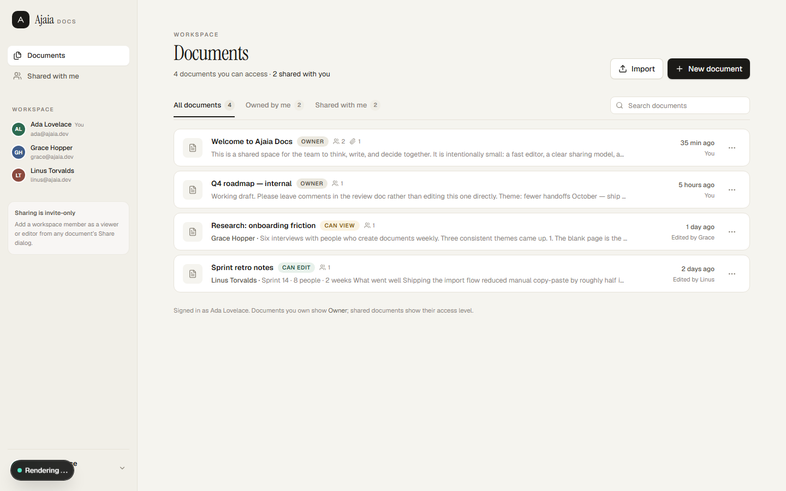
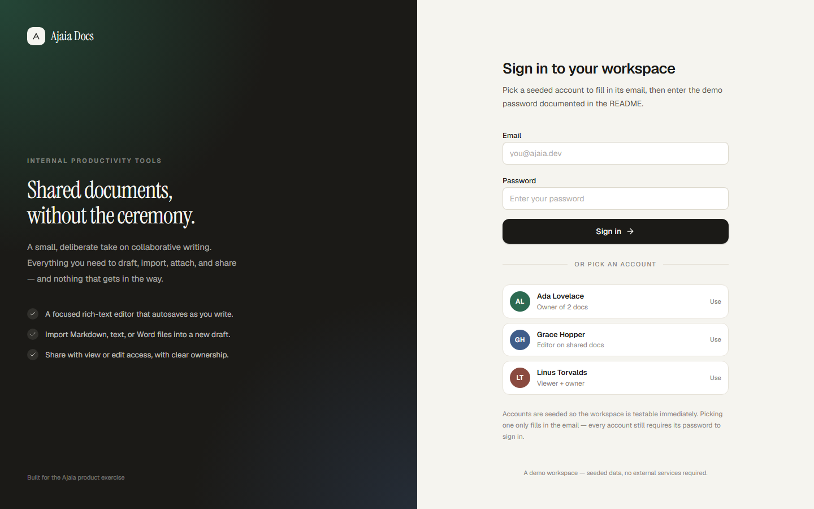
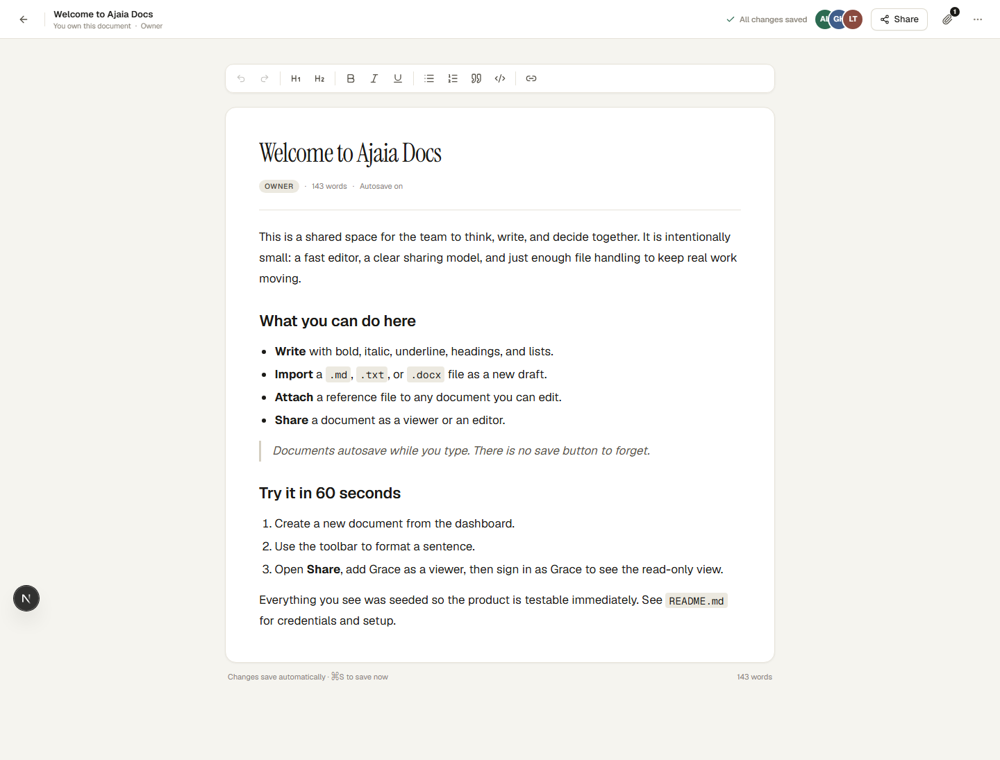
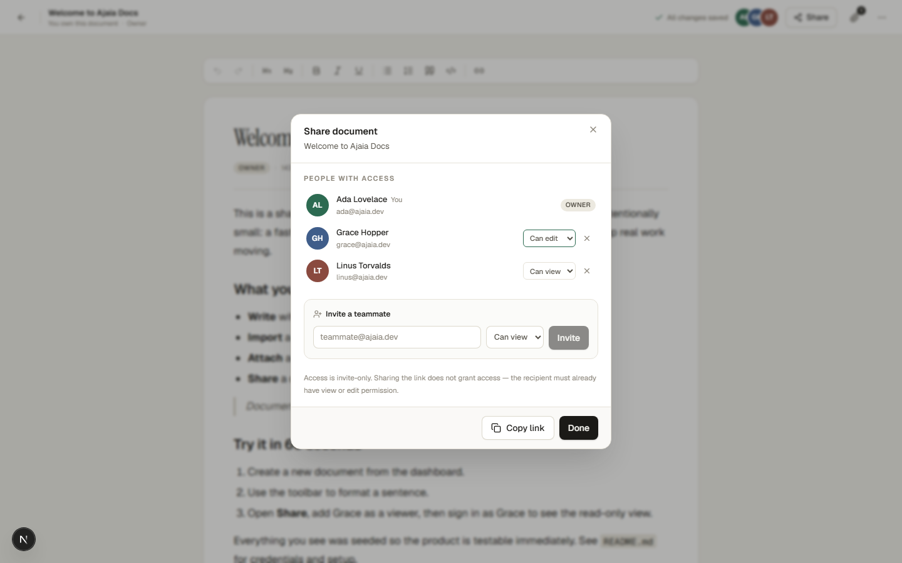
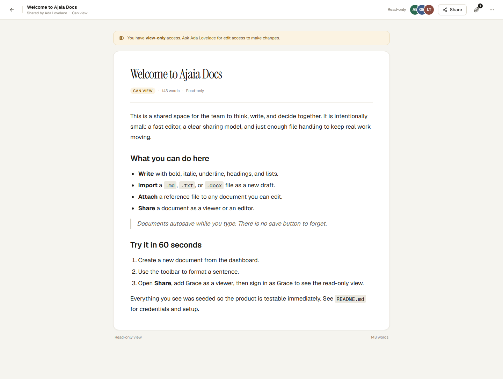
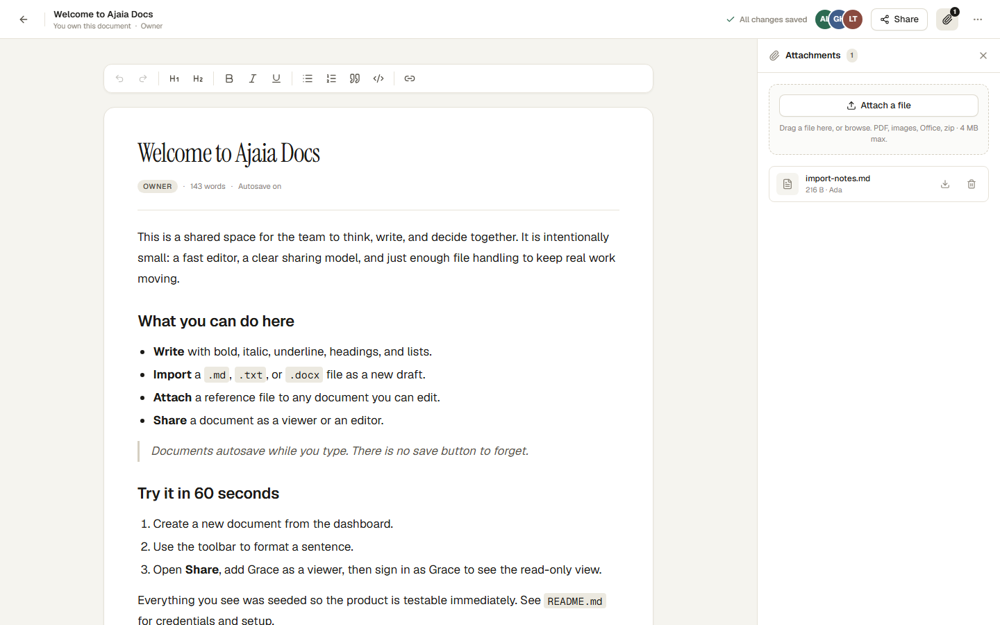
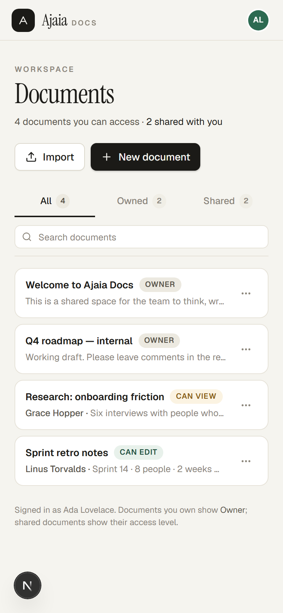

# Ajaia Docs

A focused, full-stack collaborative document editor built for the Ajaia AI-Native Full Stack assignment. Create a document, write with rich formatting, import a file, attach a reference, and share it with a teammate — with clear ownership and access levels.

**Stack:** Next.js 16 (App Router, Route Handlers) · React 19 · TipTap · Tailwind CSS 4 · libSQL / SQLite · Turso (production) · Vercel

> **Live demo:** <https://ai-native-full-stack-developer-assi-three.vercel.app> — see [Deploy](#deploy-to-vercel) and [`SUBMISSION.md`](./SUBMISSION.md).
>
> **Demo accounts** (all use password `demo1234`):
>
> | Account | Email | Why it matters |
> | --- | --- | --- |
> | Ada Lovelace | `ada@ajaia.dev` | Owns two documents, can edit two shared ones |
> | Grace Hopper | `grace@ajaia.dev` | Editor on Ada's docs, owns one of her own |
> | Linus Torvalds | `linus@ajaia.dev` | **Viewer** on "Welcome to Ajaia Docs" (read-only demo) |



---

## What is working

| Area | Behavior |
| --- | --- |
| **Documents** | Create, rename inline or from the dashboard, edit, autosave, reopen, delete (owner only). |
| **Rich text** | Bold, italic, underline, H1/H2, bulleted and numbered lists, blockquote, code block, links, undo/redo, word count. |
| **Persistence** | Every edit is saved to SQLite/libSQL within ~0.8s; formatting survives refresh and re-login. |
| **Import** | Upload `.md`, `.markdown`, `.txt`, or `.docx` → new editable document. Markdown/Word formatting is converted to editor HTML. |
| **Attachments** | Attach PDF, images, Office files, CSV, Markdown, text, JSON, or zip (4 MB max) to any document you can edit; download or remove them. Stored in the database. |
| **Sharing** | Owner invites an existing workspace member as **viewer** or **editor**; role changes and removals take effect immediately. Viewers get a read-only editor and a clear banner. |
| **Ownership view** | Dashboard tabs for *All / Owned by me / Shared with me*, with `Owner`, `Can edit`, and `Can view` badges on every row. |
| **Auth** | Seeded accounts, password hashing (scrypt), hashed session tokens in httpOnly cookies, 30-day sessions. |
| **Quality** | Server-side validation (Zod), HTML sanitization, friendly API errors, empty/loading/404/error states, responsive layout, 42 automated tests. |

### Intentional limits

- **Sharing is invite-only between seeded workspace members.** There is no public-link access and no sign-up flow; new email addresses return a clear "no workspace member" error.
- **No real-time co-editing.** Autosave is last-write-wins. Two people can edit the same document; the last save wins.
- **No comments, suggestions, or version history.**
- **Attachments are capped at 4 MB** and stored as BLOBs in the database (keeps the demo dependency-free, but not a production object store).
- **Search is client-side** over the documents you can already see.
- **No email delivery.** Inviting adds an existing account; nothing is emailed.
- **No rate limiting on login** in this scoped demo.

See [What I would build next](#what-i-would-build-next-with-another-24-hours).

---

## Run locally

Requirements: **Node.js 22+** and npm. No database service, API keys, or accounts are required.

```bash
npm install
npm run dev
```

Open <http://localhost:3000>. The SQLite database is created and seeded automatically at `.data/ajaia.db` on first request.

To start from clean seed data:

```bash
# stop the dev server, then:
rm -rf .data        # macOS/Linux
# Remove-Item -Recurse -Force .data   # Windows PowerShell
npm run dev
```

### Environment variables

Nothing is required locally. See [`.env.example`](./.env.example).

| Variable | Required | Purpose |
| --- | --- | --- |
| `DATABASE_URL` | Production | `libsql://…` URL from Turso. Local default: `file:./.data/ajaia.db`. |
| `DATABASE_AUTH_TOKEN` | Production | Turso database token. Never commit it. |

---

## Tests

```bash
npm test          # Vitest: permissions, sanitization, import conversion, DB integration (42 tests)
npm run lint      # ESLint
npm run typecheck # tsc --noEmit
npm run test:e2e  # Playwright: password-required sign-in, create/format/autosave/reload, share→viewer, import
```

- **Unit / integration** (`tests/`): permission matrix, share validation, HTML sanitization against XSS payloads, Markdown/plain-text/`.docx` conversion (with a real `.docx` fixture), repository behavior against a temporary database (ownership, sharing, sessions, attachments, cascade deletes).
- **End-to-end** (`e2e/`): asserts a seeded account card does not bypass the password field, then signs in as two users, creates and formats a document, waits for autosave, reloads to prove persistence, shares it as a viewer in a second browser context, verifies the viewer is read-only, signs out with the confirmation toast, and imports Markdown through the real dialog.

Playwright needs a browser once: `npx playwright install chromium`.

There is also a scripted API smoke test used during development:

```bash
npm run dev                  # in one terminal
node scripts/smoke-test.mjs  # in another (31 assertions across auth, access, upload, import)
```

---

## Deploy to Vercel

The app needs persistent storage. Vercel's filesystem is ephemeral, so production uses a **free Turso** database with the exact same SQLite/libSQL code path as local development.

1. **Create the database** (Turso free tier):

   ```bash
   turso db create ajaia-docs
   turso db show ajaia-docs --url          # libsql://…
   turso db tokens create ajaia-docs       # token
   ```

2. **Push the repo to GitHub**, then import it at [vercel.com/new](https://vercel.com/new) (framework auto-detects Next.js).

3. **Add environment variables** in Vercel → Project → Settings → Environment Variables:

   | Name | Value |
   | --- | --- |
   | `DATABASE_URL` | `libsql://ajaia-docs-<org>.turso.io` |
   | `DATABASE_AUTH_TOKEN` | the token from step 1 |

4. **Deploy.** The schema is created and demo data seeded on the first request. Open the deployment and sign in with a demo account. The live URL is recorded in [`SUBMISSION.md`](./SUBMISSION.md) and the README header.

> **Alternative:** any hosted libSQL/SQLite-compatible service works by setting `DATABASE_URL`. A Postgres deployment would require swapping `lib/sql` calls for an ORM — deliberately avoided for the timebox.

---

## How it is put together

```
src/
  app/
    login/                  seeded sign-in
    dashboard/              owned + shared document list
    doc/[id]/               editor (server gate + client editor)
    api/
      auth/{login,logout}   session cookie issue/revoke
      documents/            list, create, update, delete
      documents/[id]/shares invite / change role / remove
      documents/[id]/attachments  upload, list, delete
      attachments/[id]      authorized download
      import/               .md/.txt/.docx → new document
      users/                workspace members
  components/               dashboard, editor, UI primitives
  lib/
    db.ts                   libSQL client, schema, lazy init
    seed.ts                 3 accounts, 4 documents, shares
    repo.ts                 all queries + document/session/attachment access
    permissions.ts          single source of truth for access levels
    auth.ts                 cookie session helpers
    content.ts              sanitize + Markdown/Word/text import
    files.ts                upload allow-list, limits, safe filenames
    validation.ts           Zod schemas
tests/                      Vitest unit + DB integration
e2e/                        Playwright flows
docs/                       architecture, AI workflow, screenshots
```

**Access control in one place:** `resolveAccess(ownerId, userId, shareRole)` returns `owner | editor | viewer | null`. Every API route calls `loadDocument(id, "view" | "edit" | "manage")`, which returns **404 for documents the caller cannot see** (no id enumeration) and 403 for insufficient capability. Every query is scoped at the SQL level too, not only in the UI.

**Editing loop:** TipTap emits sanitized HTML on change → 800 ms debounce → `PATCH /api/documents/:id` → status indicator. Overlapping saves are serialized (`inFlight`/`pending` refs), `⌘S` forces a save, and a `keepalive` request flushes pending work when the tab closes. The server re-sanitizes every save; the client is never trusted.

More detail: [`docs/ARCHITECTURE.md`](./docs/ARCHITECTURE.md) · AI workflow: [`docs/AI-WORKFLOW.md`](./docs/AI-WORKFLOW.md).

---

## Screenshots

| Sign in | Editor |
| --- | --- |
|  |  |

| Share dialog | Read-only (viewer) |
| --- | --- |
|  |  |

| Attachments | Mobile |
| --- | --- |
|  |  |

---

## What I would build next (with another 2–4 hours)

1. **Presence + conflict handling** — lightweight polling heartbeat for "X is viewing", and a version column so a stale save returns a conflict instead of overwriting.
2. **Comments** — anchored threads on a text range, with resolve/unresolve. This is the most requested review primitive after sharing.
3. **Public read-only links** — signed, revocable tokens per document, clearly separated from member access.
4. **Version history** — snapshot on save (or every N saves) with a restore action.
5. **Export** — Markdown and PDF, plus "import into an existing draft" as an alternative to creating a new document.
6. **Operational hardening** — login rate limiting, attachment storage in object storage with signed URLs, and Postgres for scale.
